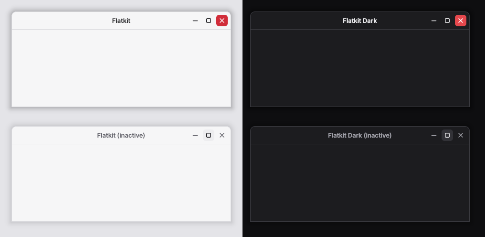

# Flatkit window decorations for KDE Plasma

Aurorae themes that make KWin's title bars match the flatkit widgets: the
kit's background colour, a 1px border-coloured outline with 10px top
corners, a hairline under the title bar, and 24px flat icon buttons that
pick up the hover and pressed colours of `KitIconButton.compact`. Close
turns red on hover like the danger button. Animations are off, so buttons
change state instantly, the same way the kit does.



Two themes: **Flatkit** (`KitColors.light`) and **Flatkit Dark**
(`KitColors.dark`).

## Install

From Plasma: System Settings → Colors & Themes → Window Decorations →
**Get New…**, search for Flatkit (once it is published on the KDE Store).


From a checkout:

```sh
kde/aurorae/install.sh            # copies both themes to ~/.local/share/aurorae/themes
kde/aurorae/install.sh --apply    # ...and switches KWin to Flatkit
kde/aurorae/install.sh --apply dark
```

Or pick it by hand: System Settings → Colors & Themes → Window Decorations,
choose **Flatkit** or **Flatkit Dark**, Apply.

Built against Plasma 6's Aurorae engine; Plasma 5 reads the same theme format.

### Recommended settings

- **Border size: Tiny** (the dropdown under the decoration list). The theme
  draws a 1px outline; larger sizes add a frame in the title bar colour.
- **Title font: Inter SemiBold 10pt** (System Settings → Fonts → Window
  title). Inter ships in this repo under `fonts/`; copy it to
  `~/.local/share/fonts` if it isn't installed.
- **Buttons:** the theme draws minimize, maximize/restore, close, keep
  above/below, on all desktops, shade and help.

## Changing the theme

The SVGs are generated. Edit the colours or sizes in `generate.py` (they
mirror `lib/src/theme.dart`) and run:

```sh
python3 kde/aurorae/generate.py
QT_QPA_PLATFORM=offscreen python3 kde/aurorae/preview.py   # needs PySide6
```

## KDE Store

`package.sh` builds one `.tar.gz` per theme into `store/`, next to a
screenshot of each and the listing text. See [store/README.md](store/README.md)
for the upload steps.
